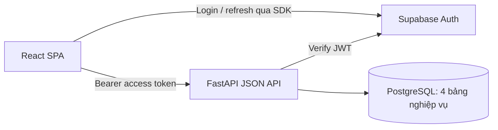

# Technical Plan — MVP Demo 

## 1. Kết quả cần trình diễn

**Chạy kiểm tra rủi ro từ chuẩn bị hàng, bàn giao đến giao cho khách → phát hiện đơn có nguy cơ gặp vấn đề như trễ hoặc đã trễ → logistics nhận xử lý từng sự cố → store staff bổ sung thông tin → logistics ghi nhận đã xử lý → cả hai thấy lịch sử cập nhật.**

- Hai vai trò: **Logistics Coordinator** và **Store Staff**; tạo sẵn hai tài khoản Supabase.
- Dùng 5–10 đơn hàng tổng hợp của Sweden, có hai mã cửa hàng để kiểm tra scope.
- Demo mặc định chạy local. Không tích hợp ERP/OMS/WMS thật, không xây quy trình production.


## 2. 5 chức năng chính

| Chức năng | Phạm vi phải làm trong demo |
| --- | --- |
| **Danh sách và chi tiết đơn có nguy cơ** | Một bảng đơn hàng có lọc trạng thái/giai đoạn; một trang chi tiết hiển thị dữ liệu mẫu, các sự cố, người phụ trách từng sự cố, ghi chú và lịch sử. |
| **Phát hiện nguy cơ và ghi nhận trễ** | Bốn rule cố định ở backend cho chuẩn bị hàng, bàn giao, dự kiến giao trễ và quá hạn giao; coordinator bấm nút **Kiểm tra rủi ro** để chạy trên dữ liệu mẫu. Hiển thị kết quả từng rule, phân biệt có nguy cơ/đã trễ và lần kiểm tra gần nhất. |
| **Thông báo sự cố** | Banner/badge số sự cố NEW và danh sách cập nhật gần đây, đọc từ incident/events bằng polling. Không có inbox độc lập hay trạng thái đã đọc bền vững. |
| **Phân công và theo dõi xử lý** | Coordinator tự nhận việc; NEW → IN_PROGRESS → RESOLVED. Hai role thêm ghi chú; chỉ owner được ghi nhận giải quyết. |
| **Lịch sử và đo lường cơ bản** | Timeline sự kiện và ba số đếm trên dashboard: mới, đang xử lý, đã xử lý. Lưu thời điểm nhận/giải quyết để hiển thị từng hồ sơ. |

Store Staff xem đơn của cửa hàng mình, theo dõi owner/tiến độ và bổ sung thông tin khách hàng. Logistics Coordinator xem các đơn trong tập demo, tiếp nhận và điều phối qua ghi chú. Kho/vận chuyển không có tài khoản hay giao diện riêng.

## 3. Stack 

| Thành phần | Quyết định cho demo |
| --- | --- |
| Frontend | **ReactJS + TypeScript + Vite**, React Router cho ba trang chính. |
| Server state | **Giữ TanStack Query 5.x** cho query, polling và refetch sau mutation. Dùng một số hooks cơ bản, không làm cache phức tạp. |
| Form/UI | Form nhỏ bằng useState, CSS đơn giản và vài components dùng chung; không cần React Hook Form hoặc design system riêng. |
| Backend | **Python + FastAPI + Pydantic**, SQLAlchemy và psycopg. |
| Database | **PostgreSQL**, local qua Docker hoặc database development đã có sẵn. Chốt một môi trường dùng chung ngay ngày 1. |
| Auth | **Supabase Auth trực tiếp từ React**; FastAPI xác minh JWT và kiểm tra profile/role/store scope. |
| Contract | `contracts/api.md` có endpoints, JSON examples và types đã thống nhất. Dùng `/docs` của FastAPI; chưa làm code generation. |
| Mock frontend | Một API adapter/mock file cùng TypeScript interface; không cần MSW. |
| Kiểm thử | Một số pytest trọng yếu và kiểm thử thủ công xuyên suốt bằng hai browser contexts. |


## 4. Kiến trúc và auth 



- React dùng `@supabase/supabase-js`: `signInWithPassword`, session theo SDK, auto-refresh theo SDK và `signOut` với scope local.
- API client lấy access token hiện tại từ SDK rồi gửi `Authorization: Bearer ...`. Không viết refresh token storage/rotation riêng hoặc lưu thêm một bản token ở nơi khác.
- FastAPI xác minh JWT qua `get_claims(jwt=...)` hoặc JWKS verifier: chữ ký, issuer của project, audience, expiry và sub. Cache JWKS theo SDK; không cần gọi Auth server ở mọi request nếu xác minh được bằng khóa đã cache.
- Backend dùng sub đã xác minh để tìm profile active và kiểm tra role/store_code. Không lấy quyền từ form hoặc user_metadata.
- Tạo sẵn tài khoản bằng Supabase Dashboard, rồi seed profile với đúng Supabase user UUID. Tắt public sign-up; chưa làm UI đăng ký, quên mật khẩu, invitation hay SSO.
- Dùng hai browser profiles hoặc cửa sổ thường + ẩn danh để demo hai role. Hai tab cùng browser context có thể chia sẻ phiên Supabase.
- Frontend dùng publishable key; không có secret/admin key trong browser. Backend không nhận password và không lưu token người dùng.
- Local cho phép origin frontend qua CORS với Authorization/Content-Type; không dùng cookie auth hoặc credentials mode. Backend vẫn kiểm tra quyền trên mọi endpoint, kể cả khi frontend ẩn nút.

Tham khảo: [Supabase Auth cho React](https://supabase.com/docs/guides/auth/quickstarts/react), [xác minh JWT bằng Python](https://supabase.com/docs/reference/python/auth-getclaims).

## 5. Cấu trúc repo và chia việc

```text
frontend/                       # Dev Frontend
  src/
    main.tsx
    App.tsx
    api/
      client.ts                 # fetch + Bearer token + xử lý lỗi
      types.ts                  # Types thủ công khớp contracts/api.md
      mock.ts                   # Dữ liệu/API mock khi backend chưa sẵn sàng
    auth/
      supabase.ts               # Client SDK
      AuthProvider.tsx
    pages/
      LoginPage.tsx
      OrdersPage.tsx            # Bảng, filters, counts, banner/activity
      OrderDetailPage.tsx       # Các incidents, nhận việc, notes, resolve, timeline
    components/                 # Badge, table, note form, loading/error
    styles.css
  package.json
  pnpm-lock.yaml
  vite.config.ts
  .env.example
backend/                        # Dev Backend
  app/
    main.py
    config.py
    db.py
    models.py                   # 4 bảng
    schemas.py                  # Pydantic request/response
    auth.py                     # Verify JWT, current profile, permissions
    rules.py                    # Bốn rule thuần + tổng hợp kết quả, nhận now để kiểm thử
    services.py                 # Workflow, scope, transactions
    routes.py                   # Các JSON endpoints
    seed.py                     # Tạo/reset dữ liệu demo
  tests/
    test_rules.py
    test_workflow.py
    test_permissions.py
  pyproject.toml
  uv.lock
  .env.example
contracts/
  api.md                        # chốt các api
compose.yaml                    # Chỉ PostgreSQL local nếu cần
plan.md
technical.md
```

| Người | Phần phụ trách | Có thể làm độc lập |
| --- | --- | --- |
| **Dev Frontend** | React, Supabase login, API client, bảng/detail, forms, polling, badge/activity và UI errors. | Dùng mock adapter theo contract khi endpoint chưa sẵn sàng; mock auth chỉ trong local development. |
| **Dev Backend** | Schema/seed, JWT/permissions, rule, APIs, ownership, notes, timeline và tests trọng yếu. | Dùng `/docs`/HTTP client/pytest mà không cần UI hoàn tất. |
| **Cả hai** | Chốt request/response, role/status enums, IDs của dữ liệu mẫu; tích hợp và diễn tập. | Thống nhất bốn rule và contract nhiều incident trước khi triển khai; kiểm thử chung lúc tích hợp. |


## 6. Database: 4 bảng

| Bảng | field |
| --- | --- |
| `profiles` | `id` UUID = Supabase user ID, `display_name`, `role=LOGISTICS_COORDINATOR\|STORE_STAFF`, `store_code` nullable cho logistics, `active`. |
| `orders` | `id`, `order_number` unique, `store_code`, `customer_reference`, `planned_handover_at` nullable, `original_delivery_due_at` nullable, `estimated_delivery_at` nullable, `dispatched_at` nullable, `delivered_at` nullable, `warehouse_status=NOT_READY\|READY\|UNKNOWN`, `delivery_status=NOT_DISPATCHED\|DISPATCHED\|DELIVERED\|UNKNOWN`, `data_verified_at` nullable, `risk_status=NOT_CHECKED\|AT_RISK\|CLEAR\|UNKNOWN`, `risk_reason` nullable, `risk_assessments` JSONB mặc định `[]`, `assessed_at` nullable. |
| `incidents` | `id`, `order_id` FK orders, `risk_code`, `alert_type=RISK\|DELAYED`, `status=NEW\|IN_PROGRESS\|RESOLVED`, `assignee_id` nullable FK profiles, `created_at`, `accepted_at`, `resolved_at`, `resolution_note`, `version` mặc định 0; unique `(order_id, risk_code)`. |
| `incident_events` | `id`, `incident_id` FK, `type=DETECTED\|ACCEPTED\|NOTE_ADDED\|RESOLVED`, `actor_id` nullable cho system event, `text`, `created_at`. |

- Store code là giá trị seed cố định như SE01/SE02, chưa cần bảng stores hoặc màn hình quản lý scope.
- Logistics được xem tập đơn demo; Store Staff chỉ xem `order.store_code == profile.store_code`. Lọc tại backend cho cả list, detail, notes và activity.
- Một đơn có nhiều incident thuộc các rule khác nhau. Không đặt unique trên riêng `order_id`; unique `(order_id, risk_code)` chặn trùng cùng loại sự cố, kể cả khi đã RESOLVED. Mỗi incident có assignee, workflow và timeline riêng; chưa xử lý cùng loại sự cố tái diễn hoặc reopen.
- `original_delivery_due_at` là hạn giao cam kết ban đầu; `estimated_delivery_at` là dự kiến giao mới nhất từ dữ liệu mô phỏng, có thể thay đổi và không thay thế hạn cam kết. `dispatched_at`/`delivered_at` ghi thời điểm thực tế xuất giao/giao thành công.
- Dữ liệu mô phỏng phải nhất quán: `NOT_DISPATCHED` chưa có các mốc thực tế; `DISPATCHED` có `dispatched_at` và chưa có `delivered_at`; `DELIVERED` có cả hai, với `dispatched_at <= delivered_at <= now`. Ngày giao thực tế so với hạn ban đầu cho biết đã giao đúng hạn hay trễ; kết quả này tách khỏi cảnh báo đang còn hiệu lực.
- `risk_assessments` lưu kết quả mới nhất của bốn rule, mỗi phần tử gồm `{risk_code, status, alert_type, reason, assessed_at}`. `status=AT_RISK|CLEAR|UNKNOWN`; `alert_type=RISK|DELAYED` chỉ có khi `AT_RISK`, còn lại null. `risk_status`/`risk_reason` là tổng hợp để hiển thị nhanh; trước lần kiểm tra đầu tiên là `NOT_CHECKED`, `risk_assessments=[]`, `assessed_at=null`. Giữ bốn bảng, chưa lưu lịch sử mọi lần đánh giá; lịch sử sự cố nằm trong incident/events.
- Event được ghi cùng transaction khi tạo incident/nhận việc/giải quyết. Ghi chú là event, không có bảng notes riêng.
- Timestamp lưu UTC có timezone; UI hiển thị Europe/Stockholm. Ngày giao ban đầu chỉ đọc; giải quyết incident không đổi lịch, ETA hoặc đánh dấu đơn đã giao.

## 7. Rule và workflow

### 7.1. Bốn rule cho quá trình giao hàng

Mỗi rule đánh giá độc lập, dùng cùng một `now` trong mỗi lần chạy. Bảng dưới áp dụng khi dữ liệu cần thiết hợp lệ và còn mới:

| Rule (`risk_code`) | Điều kiện phát hiện | Kết quả |
| --- | --- | --- |
| `WAREHOUSE_NOT_READY_BEFORE_HANDOVER` | `delivery_status=NOT_DISPATCHED`, `warehouse_status=NOT_READY` và `planned_handover_at - 120 phút <= now <= planned_handover_at`. | `AT_RISK`, `alert_type=RISK`: nguy cơ chậm bàn giao. |
| `HANDOVER_OVERDUE` | `delivery_status=NOT_DISPATCHED` và `now > planned_handover_at`, kể cả khi kho đã READY. | `AT_RISK`, `alert_type=DELAYED`: đã trễ bàn giao. |
| `DELIVERY_ETA_LATE` | `delivery_status=DISPATCHED`, `now <= original_delivery_due_at` và `estimated_delivery_at > original_delivery_due_at`. | `AT_RISK`, `alert_type=RISK`: dự kiến giao trễ. |
| `DELIVERY_OVERDUE` | `delivery_status` là `NOT_DISPATCHED` hoặc `DISPATCHED` và `now > original_delivery_due_at`. | `AT_RISK`, `alert_type=DELAYED`: đã quá hạn nhưng chưa giao. |

`AT_RISK` được giữ làm trạng thái tổng hợp cho cả nguy cơ và đã trễ; UI phải dùng `alert_type` để ghi đúng nhãn. Tại đúng giờ bàn giao/hạn giao chưa tính là quá hạn; quá mốc đó mới áp dụng rule `*_OVERDUE`.

**Cách đọc kết quả của từng rule**

| Kết quả | Ý nghĩa |
| --- | --- |
| `AT_RISK` | Có nguy cơ trễ hoặc đã trễ, theo điều kiện trong bảng trên. |
| `CLEAR` | Rule này không có cảnh báo hoặc không áp dụng ở giai đoạn hiện tại. Không có nghĩa là đơn chắc chắn sẽ giao đúng hạn. |
| `UNKNOWN` | Chưa đủ dữ liệu đáng tin để kết luận; cần xác minh thêm. |

**Bước 1 — Xem đơn đang ở giai đoạn nào**

Dùng `delivery_status` để chọn các rule cần kiểm tra:

| Trạng thái đơn | Các rule cần kiểm tra |
| --- | --- |
| `NOT_DISPATCHED` — chưa bàn giao cho vận chuyển | Hai rule bàn giao và rule quá hạn giao. Rule ETA trả `CLEAR` vì đơn chưa xuất giao. |
| `DISPATCHED` — đã xuất giao, đang vận chuyển | Rule ETA và rule quá hạn giao. Hai rule bàn giao trả `CLEAR`, không cần thông tin kho hay giờ bàn giao dự kiến. |
| `DELIVERED` — đã giao xong | Cả bốn rule trả `CLEAR` nếu có đủ mốc thực tế hợp lệ: `dispatched_at <= delivered_at <= now`. Thiếu hoặc mâu thuẫn các mốc này thì cả bốn trả `UNKNOWN`. |
| `UNKNOWN` — chưa xác định được trạng thái | Cả bốn rule trả `UNKNOWN`. |

Với đơn đã giao xong, không cần kiểm tra thông tin kho, giờ bàn giao dự kiến, ETA hay độ mới của trạng thái. Nếu có hạn giao, so sánh `delivered_at` với `original_delivery_due_at` để hiển thị **đã giao đúng hạn/trễ** riêng; không tạo cảnh báo đang trễ cho đơn đã hoàn tất.

**Bước 2 — Kiểm tra dữ liệu có đủ mới không**

Với đơn chưa giao xong, `data_verified_at` là thời điểm xác minh dữ liệu gần nhất. Nếu thiếu mốc này, mốc nằm trong tương lai hoặc đã cũ **hơn 60 phút**, các rule cần biết trạng thái hiện tại trả `UNKNOWN`. Dữ liệu đúng 60 phút vẫn được chấp nhận. Không dùng dữ liệu cũ để tự đoán đơn đã xuất giao hay chưa.

**Bước 3 — Chỉ yêu cầu dữ liệu mà từng rule cần**

- **Kho chưa sẵn sàng (`WAREHOUSE_NOT_READY_BEFORE_HANDOVER`):** Với đơn chưa xuất giao, cần giờ bàn giao dự kiến để xác định khoảng cảnh báo: từ 120 phút trước đến đúng giờ bàn giao. Ngoài khoảng này trả `CLEAR`, không cần biết trạng thái kho. Trong khoảng này: kho `NOT_READY` → `AT_RISK`; `READY` → `CLEAR`; `UNKNOWN` → `UNKNOWN`.
- **Trễ bàn giao (`HANDOVER_OVERDUE`):** Với đơn chưa xuất giao, chỉ cần giờ bàn giao dự kiến. Quá giờ mà vẫn chưa xuất giao → `AT_RISK`, kể cả khi kho đã sẵn sàng. Chưa quá giờ → `CLEAR`.
- **Dự kiến giao trễ (`DELIVERY_ETA_LATE`):** Với đơn đang vận chuyển, cần hạn giao trước. Nếu đã quá hạn, rule này trả `CLEAR` và để rule quá hạn giao cảnh báo. Nếu chưa quá hạn, kiểm tra ETA (thời gian dự kiến giao đến khách): thiếu ETA hoặc ETA nằm trong quá khứ → `UNKNOWN`; ETA vượt hạn giao → `AT_RISK`; ETA hợp lệ không vượt hạn → `CLEAR`.
- **Đã quá hạn giao (`DELIVERY_OVERDUE`):** Với đơn chưa giao xong, chỉ cần trạng thái giao đáng tin và hạn giao. Quá hạn → `AT_RISK`; chưa quá hạn → `CLEAR`. Không cần ETA hay thông tin kho. Một đơn chưa xuất giao có thể đồng thời trễ bàn giao và quá hạn giao cho khách; đây là hai sự cố khác nhau.

**Nguyên tắc khi thiếu dữ liệu:** Rule nào cần dữ liệu bị thiếu/không hợp lệ thì rule đó trả `UNKNOWN`; các rule khác vẫn đánh giá bình thường. Ví dụ, thiếu giờ bàn giao chỉ ảnh hưởng hai rule bàn giao; thiếu hạn giao ảnh hưởng hai rule giao hàng. Thiếu ETA không ngăn hệ thống phát hiện đơn đã quá hạn giao.

**Tổng hợp kết quả của đơn**

`risk_status` là kết quả chung, theo thứ tự ưu tiên **`AT_RISK` > `UNKNOWN` > `CLEAR`**:

| Kết quả của bốn rule | `risk_status` của đơn |
| --- | --- |
| Có ít nhất một rule `AT_RISK`, dù rule khác là `UNKNOWN` | `AT_RISK` |
| Không có `AT_RISK`, nhưng có ít nhất một `UNKNOWN` | `UNKNOWN` |
| Cả bốn rule đều `CLEAR` | `CLEAR` |

Ví dụ: lúc 17:00, đơn vẫn đang vận chuyển, trạng thái vừa được xác minh và hạn giao là 16:00. Dù thiếu ETA, rule quá hạn giao vẫn trả `AT_RISK`, nên kết quả chung là `AT_RISK`.

Lưu đủ bốn kết quả vào `risk_assessments` cùng thời điểm kiểm tra `assessed_at`. `risk_reason` tóm tắt cảnh báo; nếu không có cảnh báo thì ghi lý do cần xác minh, nếu có. Giao diện vẫn hiển thị kết quả từng rule, kể cả `UNKNOWN` khi kết quả chung đã là `AT_RISK`.

Coordinator nhấn **Kiểm tra rủi ro**; backend đánh giá các đơn demo và tạo incident NEW + DETECTED event cho từng rule `AT_RISK` chưa có cặp `(order_id, risk_code)`, kể cả khi đơn đã có incident của rule khác. Assessment, incident mới và event được lưu cùng transaction; chạy lại không nhân đôi incident/event và không đổi owner/workflow của incident hiện có. Đây là kiểm tra được kích hoạt khi trình diễn, **không phải hệ thống theo dõi nền liên tục**.

Hai ngưỡng 60/120 phút là cấu hình demo. Seed tính timestamps tương đối với lúc chạy, có tình huống cho cả bốn rule, đúng hạn, thiếu ETA và dữ liệu cũ. Không tự tính ETA từ khoảng cách; ETA là dữ liệu mô phỏng do nguồn vận chuyển cung cấp.

Để trình diễn một đơn đi qua nhiều giai đoạn, bổ sung lệnh mô phỏng `uv run python -m app.seed --advance-demo ORDER_NUMBER --stage dispatched|delivered`. Lệnh chỉ cập nhật đơn demo đã được seed, trạng thái/mốc thực tế/ETA và `data_verified_at`, giữ nguyên hạn cam kết cùng incident/events, không reset dữ liệu. Kịch bản cố định phải nhất quán và cho phép đơn đang có sự cố kho chuyển sang xuất giao với ETA trễ. Sau đó bấm kiểm tra lại để tạo sự cố giao hàng trên cùng đơn. Lặp cùng stage không sửa lại mốc thực tế; từ chối chuyển lùi hoặc bỏ qua bước. Chưa thêm form sửa trạng thái hay tích hợp vận chuyển thật.

### 7.2. Ba thao tác phối hợp

| Thao tác | Quyền/điều kiện | Kết quả |
| --- | --- | --- |
| **Nhận xử lý** | Logistics; incident NEW; expected_version đúng. | Tự gán assignee, chuyển IN_PROGRESS, lưu accepted_at, tăng version và ghi ACCEPTED event. |
| **Thêm ghi chú** | Hai role trong scope; text không rỗng. | Ghi NOTE_ADDED cùng actor/time; dùng để yêu cầu hỗ trợ hoặc cập nhật khách hàng/kho. |
| **Ghi nhận giải quyết** | Logistics là assignee; IN_PROGRESS; expected_version đúng; resolution_note không rỗng. | Chuyển RESOLVED, lưu resolved_at/nội dung xác nhận xử lý, tăng version và ghi event. |

Dùng conditional UPDATE theo status/version để hai người cùng nhận cùng incident chỉ có một người thắng; bên còn lại nhận 409. Không cần Idempotency-Key framework; frontend không tự retry mutation và disable nút khi đang gửi. Chạy rule dùng unique `(order_id, risk_code)`/ON CONFLICT để chống trùng; chỉ ghi DETECTED khi insert incident thành công.

Không tự resolve chỉ vì rule chuyển CLEAR hoặc đơn đã giao xong. UI hiển thị cả kết quả hiện tại và workflow của từng incident; việc xử lý sự cố không đồng nghĩa với việc đơn đã giao. Không có thao tác đổi lịch cam kết hoặc đánh dấu giao thành công trên UI; chuyển giai đoạn chỉ qua lệnh mô phỏng ở trên. Nếu cần khách chấp thuận đổi lịch, phải bổ sung phạm vi riêng.

## 8. API contract nhỏ, chốt trước khi code

API contract là thỏa thuận giữa frontend và backend: **màn hình gọi địa chỉ nào, gửi dữ liệu gì và nhận lại gì**. Chốt tên trường và ví dụ JSON trong `contracts/api.md` ngay đầu ngày 1 để hai bên có thể làm song song.

### 8.1. Cách đọc các API bên dưới

- `GET`: lấy dữ liệu để hiển thị. `POST`: thực hiện thao tác như nhận xử lý hoặc thêm ghi chú.
- Mọi đường dẫn đều bắt đầu bằng `/api/v1`. Ví dụ `GET /me` nghĩa là gọi `GET /api/v1/me`.
- `{id}` là ID của đối tượng cần thao tác: `/orders/{id}` dùng ID đơn hàng; `/incidents/{id}/...` dùng ID sự cố.
- **Order** là đơn hàng; **incident** là một sự cố của đơn; **event** là một bản ghi trong lịch sử, ví dụ nhận việc hoặc thêm ghi chú. Một đơn có thể có nhiều sự cố.
- “Trong phạm vi được xem” (scope) nghĩa là chỉ lấy dữ liệu tài khoản có quyền truy cập; nhân viên cửa hàng chỉ xem dữ liệu cửa hàng mình.

### 8.2. API lấy dữ liệu cho màn hình

| API | Khi nào frontend gọi? | Backend trả về gì? |
| --- | --- | --- |
| `GET /me` | Sau khi đăng nhập, để biết người dùng là ai và được làm gì. | `Profile`: `id`, `display_name`, `role`, `store_code`. |
| `GET /orders` | Khi mở hoặc làm mới danh sách đơn hàng. | `{items: OrderSummary[]}`: danh sách đơn trong phạm vi được xem. Mỗi đơn có trạng thái giao, các mốc dự kiến/thực tế, kết quả kiểm tra rủi ro và danh sách tóm tắt sự cố. Trả toàn bộ tập mẫu, chưa cần phân trang. |
| `GET /orders/{id}` | Khi mở chi tiết một đơn. | `OrderDetail`: dữ liệu nguồn mẫu của đơn, kết quả từng rule, chi tiết các sự cố và lịch sử tổng hợp. Mỗi event có `incident_id` và `risk_code` để biết thuộc sự cố nào. |
| `GET /activity` | Khi mở hoặc cập nhật danh sách hoạt động gần đây. | `{items: ActivityItem[]}`: 20 event mới nhất trong phạm vi được xem, kèm `order_id`, `order_number`, `incident_id`, `risk_code`. Sắp xếp mới nhất trước theo `created_at`, dùng `id` để giữ thứ tự ổn định khi trùng thời gian. |

### 8.3. API thực hiện thao tác

| API | Thao tác trên màn hình | Dữ liệu gửi lên và kết quả |
| --- | --- | --- |
| `POST /demo/evaluate-risks` | Logistics bấm **Kiểm tra rủi ro**. | Backend chạy bốn rule cho mỗi đơn demo, tạo sự cố mới nếu cần. Trả `{evaluated_count, created_incident_count}`: số đơn đã kiểm tra và số sự cố mới tạo. Một đơn có thể có nhiều sự cố nên số sự cố mới có thể lớn hơn số đơn. Chạy lại không tạo trùng hoặc reset sự cố đang xử lý. |
| `POST /incidents/{id}/accept` | Logistics bấm **Nhận xử lý** một sự cố đang `NEW`. | Gửi `{expected_version}`. Backend gán người đang đăng nhập làm người xử lý, chuyển sang `IN_PROGRESS`, ghi lịch sử nhận việc và trả sự cố sau cập nhật. |
| `POST /incidents/{id}/notes` | Người dùng bấm **Thêm ghi chú** trong một sự cố. | Gửi `{text}` là nội dung ghi chú, không được rỗng. Hai role đều được thêm trong phạm vi có quyền. Backend trả event ghi chú vừa tạo; thao tác này không đổi trạng thái sự cố. |
| `POST /incidents/{id}/resolve` | Người đang phụ trách bấm **Ghi nhận giải quyết** sự cố `IN_PROGRESS`. | Gửi `{expected_version, resolution_note}`; `resolution_note` là mô tả cách đã xử lý, không được rỗng. Backend chuyển sang `RESOLVED`, lưu nội dung/thời điểm giải quyết, ghi lịch sử và trả sự cố sau cập nhật. |

**Vì sao cần `expected_version`?**

Mỗi sự cố có trường `version`, tăng sau khi nhận xử lý hoặc ghi nhận giải quyết. Frontend lấy giá trị đang xem rồi gửi lại dưới tên `expected_version`; người dùng không phải nhập.

Ví dụ: bạn và A cùng xem sự cố ở phiên bản `3`. A nhận xử lý trước, sự cố chuyển sang phiên bản `4`. Nếu bạn vẫn bấm nhận với `expected_version: 3`, backend trả lỗi `409` vì dữ liệu bạn đang xem đã cũ. Cách này tránh hai người cùng nhận một sự cố hoặc cập nhật dựa trên trạng thái cũ.

API ghi chú không cần `expected_version` vì mỗi ghi chú được thêm riêng, không ghi đè hay đổi trạng thái sự cố.

Ví dụ nội dung gửi khi bấm **Ghi nhận giải quyết**:

```json
{
  "expected_version": 4,
  "resolution_note": "Đã liên hệ kho; kho xác nhận chuẩn bị kịp lịch bàn giao hiện tại."
}
```

Giải quyết một sự cố không đồng nghĩa với đơn đã giao thành công, cũng không tự giải quyết các sự cố khác của đơn.

### 8.4. Thống nhất dữ liệu trả về

Các kiểu dữ liệu (DTO) là tên gọi cho cấu trúc JSON mà hai bên cùng dùng:

| Kiểu dữ liệu | Nội dung cần thống nhất |
| --- | --- |
| `Profile` | Thông tin tài khoản từ `/me`. |
| `OrderSummary`, `OrderDetail` | Dữ liệu cho danh sách/chi tiết đơn. Kết quả kiểm tra gồm `risk_status`, `risk_reason`, `risk_assessments`, `assessed_at`. Danh sách sự cố nằm trong `incidents`: dùng `IncidentSummary[]` ở danh sách đơn, `Incident[]` ở chi tiết; chưa có sự cố thì là `[]`. Không dùng trường `incident` đơn lẻ. |
| `RuleAssessment` | Kết quả một rule, đúng cấu trúc JSONB ở mục 6. `risk_assessments` chứa đủ bốn kết quả sau lần kiểm tra đầu tiên. |
| `IncidentSummary`, `Incident` | Bản tóm tắt có `id`, `risk_code`, `alert_type`, `status`, ID/tên người xử lý (`assignee_id`, `assignee_name`). Bản chi tiết thêm `order_id`, các mốc thời gian, `resolution_note`, `version`. |
| `IncidentEvent`, `ActivityItem` | Bản ghi lịch sử của sự cố và dữ liệu hoạt động gần đây. |
| `ApiError` | Lỗi có dạng `{code, message}`; lỗi dữ liệu đầu vào có thể thêm `field_errors` để chỉ rõ trường nào sai. |

`risk_assessments` cho biết **kết quả kiểm tra hiện tại**; `incidents` cho biết **các sự cố đã phát hiện và tiến độ xử lý**. Hai phần này hiển thị riêng như mục 7.

### 8.5. Đăng nhập, định dạng và xử lý lỗi

Frontend đăng nhập/đăng xuất trực tiếp với Supabase; backend không có API login/logout riêng. Khi gọi các API cần đăng nhập, frontend gửi access token trong header `Authorization: Bearer <token>` để backend xác định tài khoản và quyền.

ID dùng UUID dạng chuỗi; thời gian dùng ISO 8601 có múi giờ; tên trường dùng `snake_case`, ví dụ `resolution_note`.

| Mã HTTP | Hiểu đơn giản | Frontend xử lý |
| --- | --- | --- |
| `401` | Chưa đăng nhập hoặc token không hợp lệ. | Yêu cầu đăng nhập lại nếu không khôi phục được phiên. |
| `403` | Đã đăng nhập nhưng vai trò không được thực hiện thao tác. | Báo không có quyền. |
| `404` | Không tìm thấy đơn/sự cố, hoặc dữ liệu nằm ngoài phạm vi được xem. | Báo không tìm thấy dữ liệu. |
| `409` | Trạng thái hoặc phiên bản sự cố đã thay đổi. | Giữ nội dung đang nhập, tải lại dữ liệu và báo có người khác cập nhật; không tự ghi đè hoặc tự gửi lại thao tác. |
| `422` | Dữ liệu gửi lên thiếu hoặc không hợp lệ. | Hiển thị lỗi ở trường tương ứng để người dùng sửa. |

## 9. Frontend tối thiểu

- **Login:** email/password, lỗi đăng nhập, logout; bảo vệ route theo auth state. Dùng SDK quản lý phiên; sau logout/đổi user phải xóa query cache.
- **Orders:** bảng 5–10 đơn, lọc risk/giai đoạn giao hàng, nhãn “Có nguy cơ”/“Đã trễ” từ kết quả hiện tại, số sự cố trên từng đơn và ba cards đếm incident NEW/IN_PROGRESS/RESOLVED trong scope. Đếm sự cố thay vì đếm đơn; nút kiểm tra rủi ro cho logistics.
- **Order detail:** trạng thái và các mốc bàn giao/hạn giao/ETA/xuất giao/giao thực tế, data_verified_at, bốn kết quả đánh giá cùng reason/assessed_at. Hiển thị từng incident với loại sự cố, status/owner, notes và nút nhận việc/resolve theo role/ownership; timeline tổng hợp ghi rõ sự cố liên quan. Trước lần kiểm tra đầu hiển thị “Chưa kiểm tra”; đơn đã giao hiển thị thực tế đúng hạn/trễ hoặc chưa đủ dữ liệu nếu thiếu hạn cam kết.
- **Activity:** badge số incident NEW và dropdown cập nhật gần đây. Poll orders/activity mỗi 10 giây khi app mở; sau mutation refetch ngay.
- Dedupe toast theo event ID trong memory; lần tải đầu chỉ hiện recent activity, không toast hàng loạt lịch sử. Không làm inbox/read-state lưu DB; các role vẫn thấy tiến độ qua cùng incident.
- Dữ liệu form tách khỏi query data để polling không xóa draft. Chỉ làm loading, empty state, thông báo lỗi và status badge cơ bản.
- Frontend mock nằm sau cùng API interface, chỉ bật trong dev. Trong mock mode không khởi tạo Supabase client nếu chưa có config; bản demo cuối cùng tắt mock và dùng API/Auth thật.

## 10. Lịch 3 ngày cho hai dev

| Ngày | Dev Frontend | Dev Backend | Kết quả cuối ngày |
| --- | --- | --- | --- |
| **Ngày 1** | React shell, login Supabase, list/detail từ mock có nhiều incident và các mốc giao hàng; API client và hooks. | 4 bảng, seed tình huống bốn rule, JWT + profiles/scope, GET me/orders/detail. | Chốt contract bốn kết quả rule và `incidents[]`; login và xem orders qua API thật chạy được. |
| **Ngày 2** | Forms theo từng incident, nút kiểm tra, nhãn nguy cơ/đã trễ, activity/polling và counts. | Bốn rule + tổng hợp, chống trùng theo order/rule, accept/notes/resolve, transaction/event, activity API và lệnh chuyển giai đoạn demo. | Chạy journey hai role; cùng một đơn có sự cố ở giai đoạn kho và giao hàng. |
| **Ngày 3** | Sửa UX, loading/errors, trạng thái 409, kiểm tra scope hiển thị. | Tests trọng yếu, sửa lỗi auth/scope/state, chuẩn bị reset seed và hướng dẫn chạy. | Dành ít nhất nửa ngày cuối để tích hợp, diễn tập và sửa lỗi; không thêm feature mới. |

Nếu chậm, bỏ toast animation, cards trang trí và bộ lọc phụ trước. Giữ auth thật, scope hai role, rule, nhận việc, ghi chú, resolve và dữ liệu lưu DB. Không dùng thời gian ngày 3 để đổi framework hoặc thêm hạ tầng.

## 11. Checklist nghiệm thu demo

- [ ] Hai tài khoản Supabase đăng nhập được và trả đúng profile.
- [ ] Store Staff không đọc được order của cửa hàng khác, cũng không tự accept/resolve qua API.
- [ ] Bốn rule phát hiện đúng: kho chưa sẵn sàng gần giờ bàn giao, quá giờ chưa xuất giao, ETA vượt hạn khi đang vận chuyển, quá hạn chưa giao. UI phân biệt nguy cơ và đã trễ.
- [ ] Kiểm tra biên: trước/đúng/sau mốc 120 phút và giờ bàn giao/hạn giao; dữ liệu đúng 60 phút vẫn hợp lệ, cũ hơn ra UNKNOWN. Khi quá hạn, rule cảnh báo trước hạn nhường cho rule quá hạn tương ứng.
- [ ] Thiếu dữ liệu chỉ làm UNKNOWN ở rule cần field đó; thiếu ETA không ngăn phát hiện đã quá hạn giao, thiếu dữ liệu kho không ảnh hưởng rule giao hàng. Trạng thái giao UNKNOWN hoặc dữ liệu trạng thái chưa giao bị stale phải được xác minh.
- [ ] Tổng hợp ưu tiên AT_RISK > UNKNOWN > CLEAR; chi tiết vẫn thấy đủ kết quả từng rule. Đơn DELIVERED có mốc thực tế hợp lệ không còn cảnh báo hiệu lực, không cần dữ liệu kho/ETA và vẫn hiển thị lịch sử giao đúng hạn/trễ khi có hạn cam kết.
- [ ] Chạy kiểm tra hai lần chỉ tạo một incident và một DETECTED event cho mỗi cặp `(order_id, risk_code)`, kể cả khi chạy cạnh tranh. Một đơn có thể tạo nhiều incident khác loại.
- [ ] Chuyển cùng một đơn từ chưa xuất giao sang DISPATCHED với ETA trễ bằng lệnh demo rồi kiểm tra lại: sự cố mới được tạo, owner/status/notes của sự cố cũ giữ nguyên. Lệnh từ chối chuyển lùi, không ghi đè mốc thực tế khi lặp cùng stage và không tạo dữ liệu thời gian mâu thuẫn.
- [ ] Coordinator nhận việc; Store Staff thấy owner/status qua polling và thêm ghi chú.
- [ ] Coordinator ghi nhận giải quyết từng incident bằng note; cả hai thấy timeline và counts cập nhật. Giải quyết một sự cố không giải quyết các sự cố khác cùng đơn; CLEAR hoặc DELIVERED không tự resolve incident.
- [ ] Hai lần Accept cạnh tranh hoặc expected_version cũ được xử lý bằng 409.
- [ ] Reload giữ dữ liệu nghiệp vụ trong DB; logout/đổi user không hiện cache user trước.
- [ ] Đã reset seed trước buổi trình diễn; 5–10 đơn bao phủ bốn rule, một đơn nhiều sự cố, CLEAR, UNKNOWN do thiếu ETA, UNKNOWN do stale, đơn đã giao đúng hạn/trễ và cửa hàng khác để kiểm tra scope. Các tình huống có thể dùng chung một đơn khi phù hợp.

Backend cần tests trọng yếu cho bốn rule/biên thời gian, dữ liệu thiếu theo rule, tổng hợp, dedupe theo order/rule, nhiều incident trên cùng đơn, chuyển giai đoạn demo, role/scope và accept/resolve guards. Hai dev kiểm thử thủ công full journey; không yêu cầu bộ CI/E2E automation đầy đủ trong 3 ngày.

## 12. Cấu hình và chạy demo

**Frontend `.env.example`:**

- `VITE_SUPABASE_URL`
- `VITE_SUPABASE_PUBLISHABLE_KEY`
- `VITE_API_BASE_URL=http://localhost:8000/api/v1`
- `VITE_USE_MOCK_API=false`

**Backend `.env.example`:**

- `DATABASE_URL`
- `SUPABASE_URL`, `SUPABASE_PUBLISHABLE_KEY`
- `FRONTEND_ORIGIN=http://localhost:5173`
- `DEMO_LOGISTICS_AUTH_ID`, `DEMO_STORE_AUTH_ID` — UUID của hai tài khoản đã tạo trong Dashboard.

Không cần admin secret trong runtime. Backend nối DB bằng SQLAlchemy; Supabase chỉ xác thực. Không mở quyền browser đọc/ghi bảng nghiệp vụ qua Supabase Data API.

Các lệnh sau là hợp đồng cho source code sẽ triển khai, chưa chạy được chỉ với tài liệu hiện tại:

```bash
cd frontend
pnpm install
pnpm dev
```

```bash
cd backend
uv sync
uv run python -m app.seed
uv run uvicorn app.main:app --reload --port 8000
```

PostgreSQL cần chạy trước bước seed. `app.seed` tạo schema/fixtures; reset dữ liệu demo phải có cờ rõ như `--reset-demo`, không tự xóa dữ liệu mỗi lần khởi động API. `--advance-demo ORDER_NUMBER --stage dispatched|delivered` chỉ chuyển giai đoạn của đơn demo như mục 7.1, giữ lịch sử sự cố và không reset tập mẫu. Trước buổi demo, reset tập mẫu và timestamp tương đối rồi chạy lại journey; khi dữ liệu trạng thái cũ hơn 60 phút, reset trước buổi demo thay vì bỏ kiểm tra độ mới. Không có lệnh worker riêng, migration pipeline hoặc deploy production trong phạm vi này.
